# Free HTML & CSS Login Form Templates

50 free login form and login page templates, written in plain HTML and CSS. Open `index.html` and it works: no jQuery, no build step, no CDN calls. Each one drops into a Bootstrap 4, 5 or 6 project unchanged, or runs with no framework at all.

⭐ **If these save you time, star this repo.** It's how other developers find them.

Live previews of every template, plus more options from other designers: **[the full collection on Colorlib](https://colorlib.com/wp/html5-and-css3-login-forms/)**.

## Contents

- [Login forms](#login-forms) (20)
- [Login forms, set two](#login-forms-set-two) (20)
- [Full login pages](#full-login-pages) (10)

## Login forms

<table>
<tr>
<td align="center" width="33%"><a href="https://preview.colorlib.com/#login-form-v1">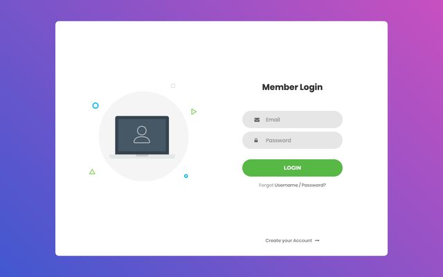</a> <b>Login Form V1</b> <a href="https://preview.colorlib.com/#login-form-v1">Demo</a> · <a href="login-form-v1/">Code</a> · <a href="https://colorlib.com/wp/template/login-form-v1/">Details</a></td>
<td align="center" width="33%"><a href="https://preview.colorlib.com/#login-form-v2">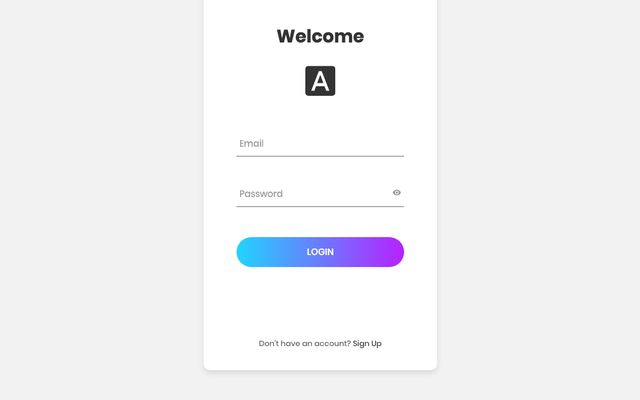</a> <b>Login Form V2</b> <a href="https://preview.colorlib.com/#login-form-v2">Demo</a> · <a href="login-form-v2/">Code</a> · <a href="https://colorlib.com/wp/template/login-form-v2/">Details</a></td>
<td align="center" width="33%"><a href="https://preview.colorlib.com/#login-form-v3">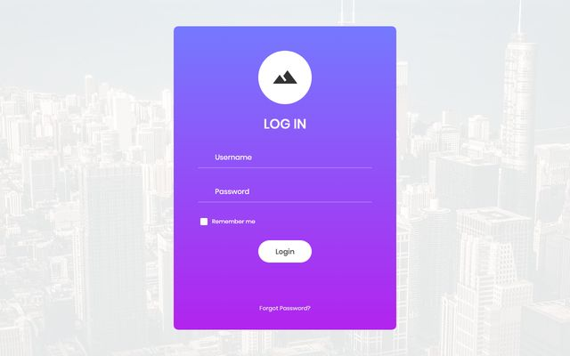</a> <b>Login Form V3</b> <a href="https://preview.colorlib.com/#login-form-v3">Demo</a> · <a href="login-form-v3/">Code</a> · <a href="https://colorlib.com/wp/template/login-form-v3/">Details</a></td>
</tr>
<tr>
<td align="center" width="33%"><a href="https://preview.colorlib.com/#login-form-v4">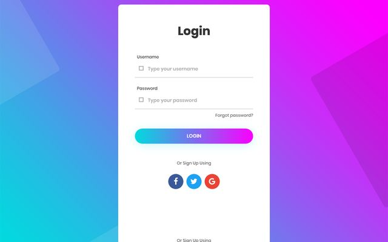</a> <b>Login Form V4</b> <a href="https://preview.colorlib.com/#login-form-v4">Demo</a> · <a href="login-form-v4/">Code</a> · <a href="https://colorlib.com/wp/template/login-form-v4/">Details</a></td>
<td align="center" width="33%"> <b>Login Form V5</b> <a href="https://preview.colorlib.com/#login-form-v5">Demo</a> · <a href="login-form-v5/">Code</a> · <a href="https://colorlib.com/wp/template/login-form-v5/">Details</a></td>
<td align="center" width="33%"><a href="https://preview.colorlib.com/#login-form-v6">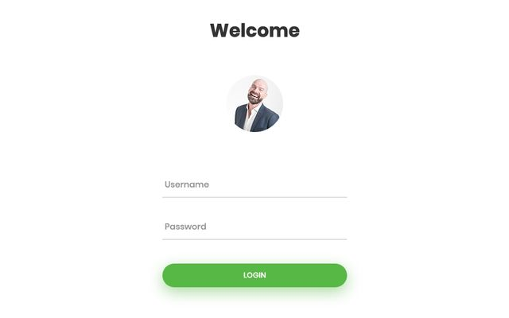</a> <b>Login Form V6</b> <a href="https://preview.colorlib.com/#login-form-v6">Demo</a> · <a href="login-form-v6/">Code</a> · <a href="https://colorlib.com/wp/template/login-form-v6/">Details</a></td>
</tr>
<tr>
<td align="center" width="33%"><a href="https://preview.colorlib.com/#login-form-v7">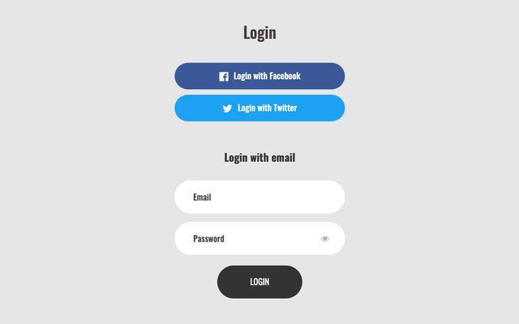</a> <b>Login Form V7</b> <a href="https://preview.colorlib.com/#login-form-v7">Demo</a> · <a href="login-form-v7/">Code</a> · <a href="https://colorlib.com/wp/template/login-form-v7/">Details</a></td>
<td align="center" width="33%"><a href="https://preview.colorlib.com/#login-form-v8">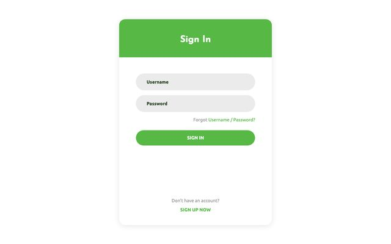</a> <b>Login Form V8</b> <a href="https://preview.colorlib.com/#login-form-v8">Demo</a> · <a href="login-form-v8/">Code</a> · <a href="https://colorlib.com/wp/template/login-form-v8/">Details</a></td>
<td align="center" width="33%"><a href="https://preview.colorlib.com/#login-form-v9">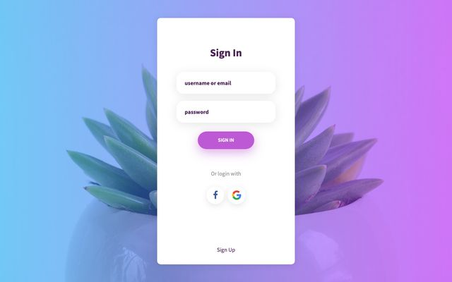</a> <b>Login Form V9</b> <a href="https://preview.colorlib.com/#login-form-v9">Demo</a> · <a href="login-form-v9/">Code</a> · <a href="https://colorlib.com/wp/template/login-form-v9/">Details</a></td>
</tr>
<tr>
<td align="center" width="33%"><a href="https://preview.colorlib.com/#login-form-v10">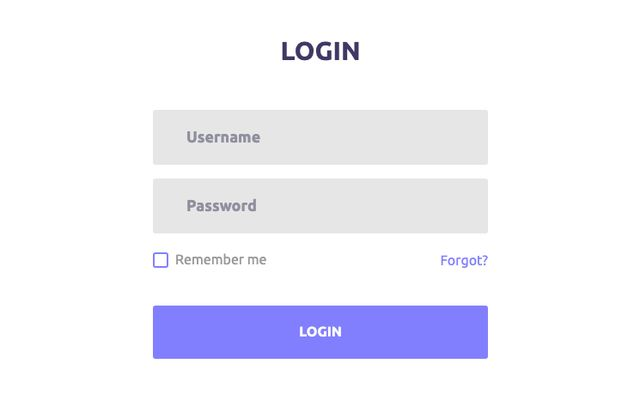</a> <b>Login Form V10</b> <a href="https://preview.colorlib.com/#login-form-v10">Demo</a> · <a href="login-form-v10/">Code</a> · <a href="https://colorlib.com/wp/template/login-form-v10/">Details</a></td>
<td align="center" width="33%"><a href="https://preview.colorlib.com/#login-form-v11">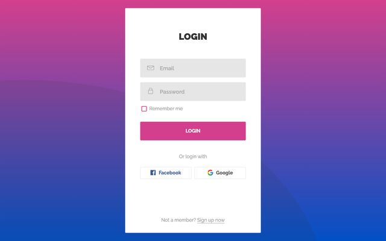</a> <b>Login Form V11</b> <a href="https://preview.colorlib.com/#login-form-v11">Demo</a> · <a href="login-form-v11/">Code</a> · <a href="https://colorlib.com/wp/template/login-form-v11/">Details</a></td>
<td align="center" width="33%"> <b>Login Form V12</b> <a href="https://preview.colorlib.com/#login-form-v12">Demo</a> · <a href="login-form-v12/">Code</a> · <a href="https://colorlib.com/wp/template/login-form-v12/">Details</a></td>
</tr>
<tr>
<td align="center" width="33%"><a href="https://preview.colorlib.com/#login-form-v13">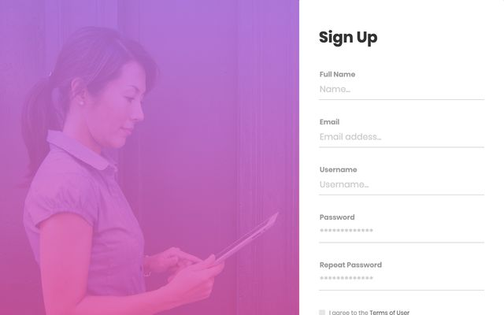</a> <b>Login Form V13</b> <a href="https://preview.colorlib.com/#login-form-v13">Demo</a> · <a href="login-form-v13/">Code</a> · <a href="https://colorlib.com/wp/template/login-form-v13/">Details</a></td>
<td align="center" width="33%"><a href="https://preview.colorlib.com/#login-form-v14">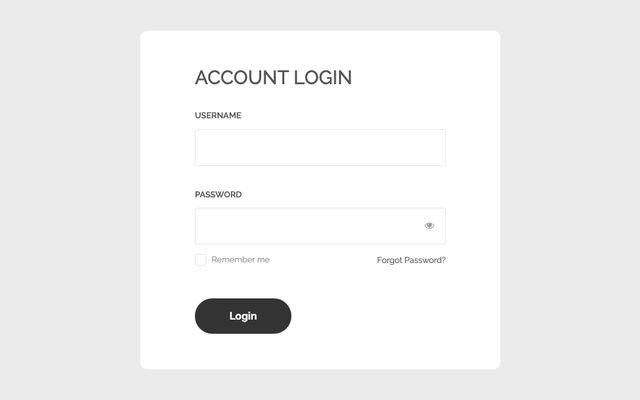</a> <b>Login Form V14</b> <a href="https://preview.colorlib.com/#login-form-v14">Demo</a> · <a href="login-form-v14/">Code</a> · <a href="https://colorlib.com/wp/template/login-form-v14/">Details</a></td>
<td align="center" width="33%"><a href="https://preview.colorlib.com/#login-form-v15">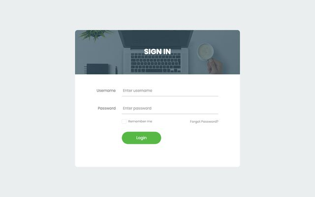</a> <b>Login Form V15</b> <a href="https://preview.colorlib.com/#login-form-v15">Demo</a> · <a href="login-form-v15/">Code</a> · <a href="https://colorlib.com/wp/template/login-form-v15/">Details</a></td>
</tr>
<tr>
<td align="center" width="33%"><a href="https://preview.colorlib.com/#login-form-v16">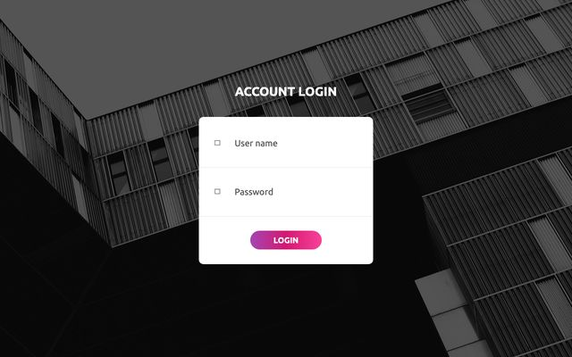</a> <b>Login Form V16</b> <a href="https://preview.colorlib.com/#login-form-v16">Demo</a> · <a href="login-form-v16/">Code</a> · <a href="https://colorlib.com/wp/template/login-form-v16/">Details</a></td>
<td align="center" width="33%"><a href="https://preview.colorlib.com/#login-form-v17">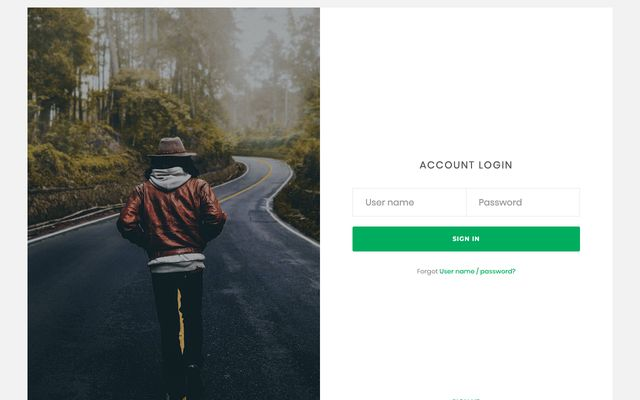</a> <b>Login Form V17</b> <a href="https://preview.colorlib.com/#login-form-v17">Demo</a> · <a href="login-form-v17/">Code</a> · <a href="https://colorlib.com/wp/template/login-form-v17/">Details</a></td>
<td align="center" width="33%"><a href="https://preview.colorlib.com/#login-form-v18">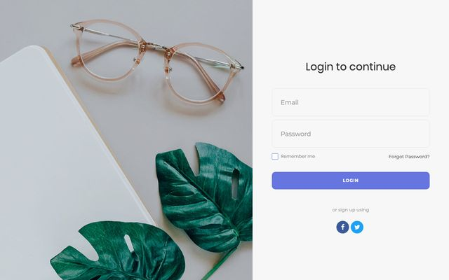</a> <b>Login Form V18</b> <a href="https://preview.colorlib.com/#login-form-v18">Demo</a> · <a href="login-form-v18/">Code</a> · <a href="https://colorlib.com/wp/template/login-form-v18/">Details</a></td>
</tr>
<tr>
<td align="center" width="33%"><a href="https://preview.colorlib.com/#login-form-v19">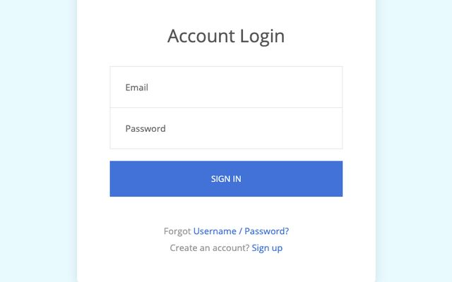</a> <b>Login Form V19</b> <a href="https://preview.colorlib.com/#login-form-v19">Demo</a> · <a href="login-form-v19/">Code</a> · <a href="https://colorlib.com/wp/template/login-form-v19/">Details</a></td>
<td align="center" width="33%"><a href="https://preview.colorlib.com/#login-form-v20">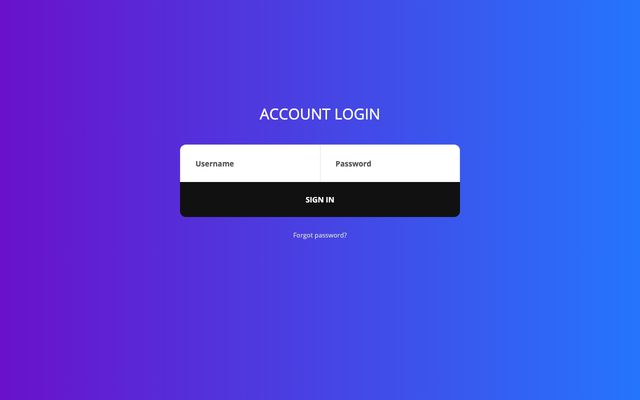</a> <b>Login Form V20</b> <a href="https://preview.colorlib.com/#login-form-v20">Demo</a> · <a href="login-form-v20/">Code</a> · <a href="https://colorlib.com/wp/template/login-form-v20/">Details</a></td>
</tr>
</table>

## Login forms, set two

<table>
<tr>
<td align="center" width="33%"><a href="https://preview.colorlib.com/#login-form-01">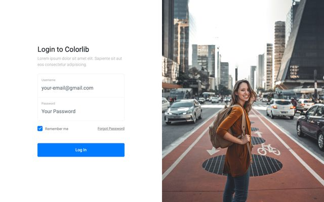</a> <b>Login Form 01</b> <a href="https://preview.colorlib.com/#login-form-01">Demo</a> · <a href="login-form-01/">Code</a> · <a href="https://colorlib.com/wp/template/login-form-01/">Details</a></td>
<td align="center" width="33%"><a href="https://preview.colorlib.com/#login-form-02">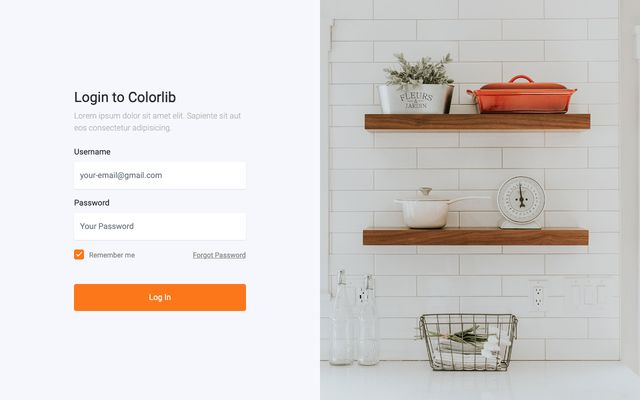</a> <b>Login Form 02</b> <a href="https://preview.colorlib.com/#login-form-02">Demo</a> · <a href="login-form-02/">Code</a> · <a href="https://colorlib.com/wp/template/login-form-02/">Details</a></td>
<td align="center" width="33%"><a href="https://preview.colorlib.com/#login-form-03">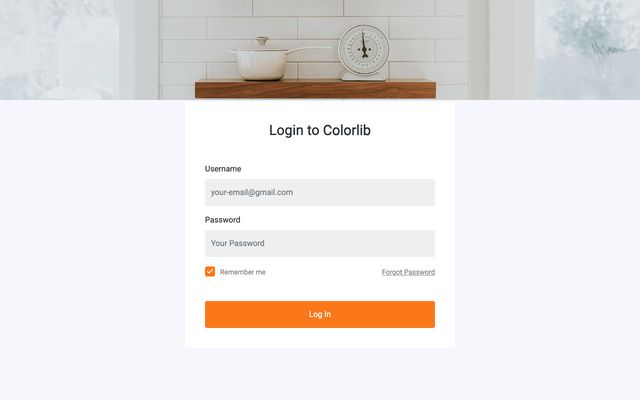</a> <b>Login Form 03</b> <a href="https://preview.colorlib.com/#login-form-03">Demo</a> · <a href="login-form-03/">Code</a> · <a href="https://colorlib.com/wp/template/login-form-03/">Details</a></td>
</tr>
<tr>
<td align="center" width="33%"><a href="https://preview.colorlib.com/#login-form-04">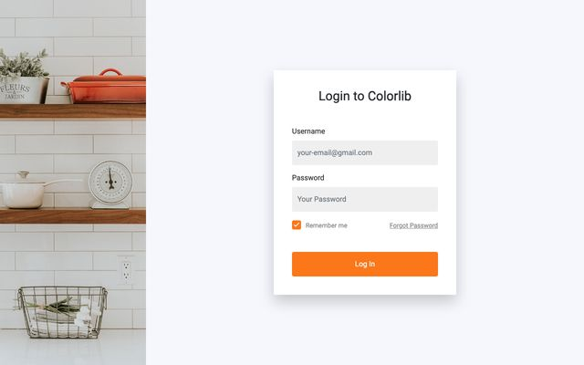</a> <b>Login Form 04</b> <a href="https://preview.colorlib.com/#login-form-04">Demo</a> · <a href="login-form-04/">Code</a> · <a href="https://colorlib.com/wp/template/login-form-04/">Details</a></td>
<td align="center" width="33%"><a href="https://preview.colorlib.com/#login-form-05">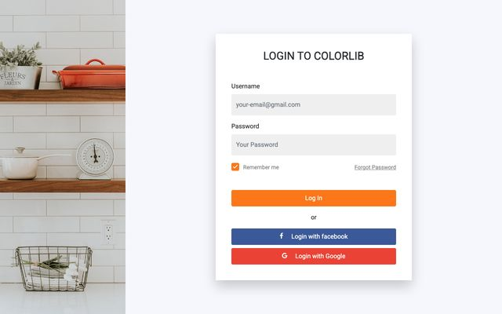</a> <b>Login Form 05</b> <a href="https://preview.colorlib.com/#login-form-05">Demo</a> · <a href="login-form-05/">Code</a> · <a href="https://colorlib.com/wp/template/login-form-05/">Details</a></td>
<td align="center" width="33%"><a href="https://preview.colorlib.com/#login-form-06">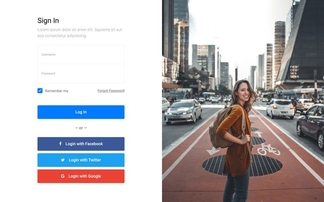</a> <b>Login Form 06</b> <a href="https://preview.colorlib.com/#login-form-06">Demo</a> · <a href="login-form-06/">Code</a> · <a href="https://colorlib.com/wp/template/login-form-06/">Details</a></td>
</tr>
<tr>
<td align="center" width="33%"><a href="https://preview.colorlib.com/#login-form-07">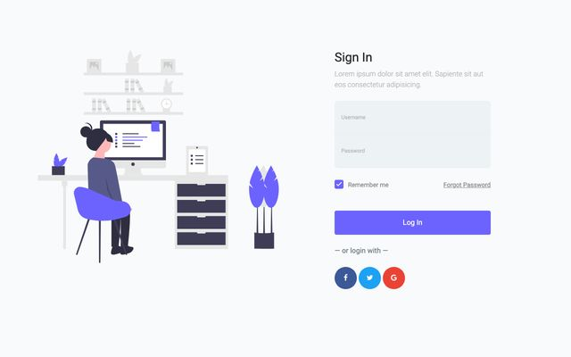</a> <b>Login Form 07</b> <a href="https://preview.colorlib.com/#login-form-07">Demo</a> · <a href="login-form-07/">Code</a> · <a href="https://colorlib.com/wp/template/login-form-07/">Details</a></td>
<td align="center" width="33%"><a href="https://preview.colorlib.com/#login-form-08">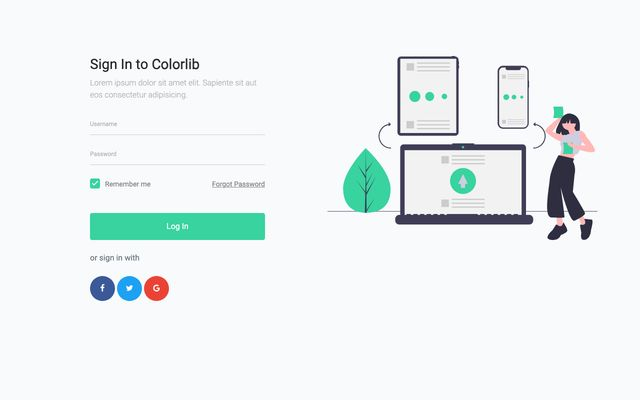</a> <b>Login Form 08</b> <a href="https://preview.colorlib.com/#login-form-08">Demo</a> · <a href="login-form-08/">Code</a> · <a href="https://colorlib.com/wp/template/login-form-08/">Details</a></td>
<td align="center" width="33%"><a href="https://preview.colorlib.com/#login-form-09">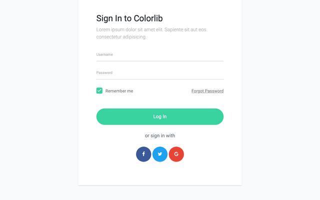</a> <b>Login Form 09</b> <a href="https://preview.colorlib.com/#login-form-09">Demo</a> · <a href="login-form-09/">Code</a> · <a href="https://colorlib.com/wp/template/login-form-09/">Details</a></td>
</tr>
<tr>
<td align="center" width="33%"><a href="https://preview.colorlib.com/#login-form-10">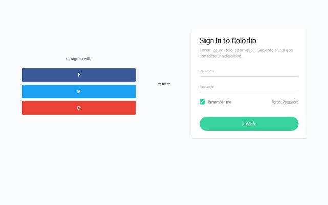</a> <b>Login Form 10</b> <a href="https://preview.colorlib.com/#login-form-10">Demo</a> · <a href="login-form-10/">Code</a> · <a href="https://colorlib.com/wp/template/login-form-10/">Details</a></td>
<td align="center" width="33%"><a href="https://preview.colorlib.com/#login-form-11">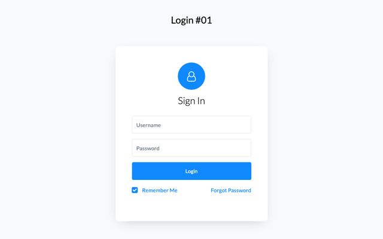</a> <b>Login Form 11</b> <a href="https://preview.colorlib.com/#login-form-11">Demo</a> · <a href="login-form-11/">Code</a> · <a href="https://colorlib.com/wp/template/login-form-11/">Details</a></td>
<td align="center" width="33%"><a href="https://preview.colorlib.com/#login-form-12">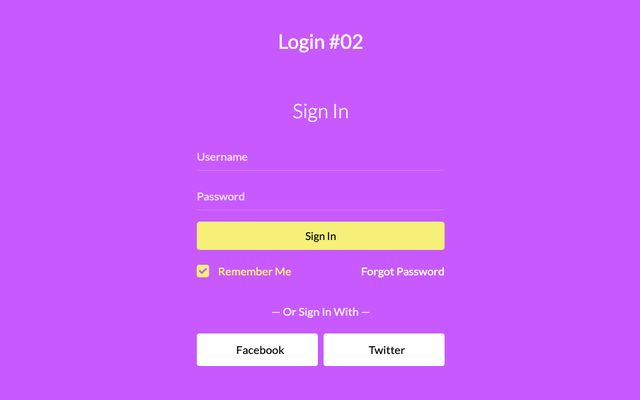</a> <b>Login Form 12</b> <a href="https://preview.colorlib.com/#login-form-12">Demo</a> · <a href="login-form-12/">Code</a> · <a href="https://colorlib.com/wp/template/login-form-12/">Details</a></td>
</tr>
<tr>
<td align="center" width="33%"><a href="https://preview.colorlib.com/#login-form-13">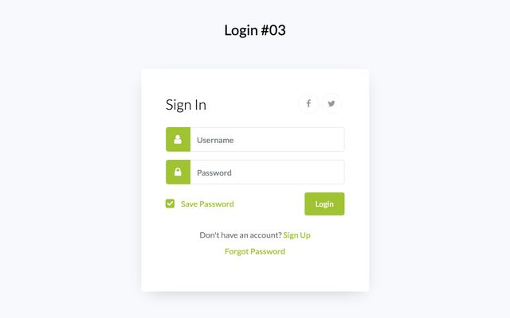</a> <b>Login Form 13</b> <a href="https://preview.colorlib.com/#login-form-13">Demo</a> · <a href="login-form-13/">Code</a> · <a href="https://colorlib.com/wp/template/login-form-13/">Details</a></td>
<td align="center" width="33%"><a href="https://preview.colorlib.com/#login-form-14">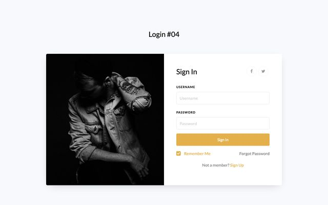</a> <b>Login Form 14</b> <a href="https://preview.colorlib.com/#login-form-14">Demo</a> · <a href="login-form-14/">Code</a> · <a href="https://colorlib.com/wp/template/login-form-14/">Details</a></td>
<td align="center" width="33%"><a href="https://preview.colorlib.com/#login-form-15">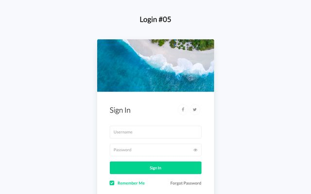</a> <b>Login Form 15</b> <a href="https://preview.colorlib.com/#login-form-15">Demo</a> · <a href="login-form-15/">Code</a> · <a href="https://colorlib.com/wp/template/login-form-15/">Details</a></td>
</tr>
<tr>
<td align="center" width="33%"><a href="https://preview.colorlib.com/#login-form-16">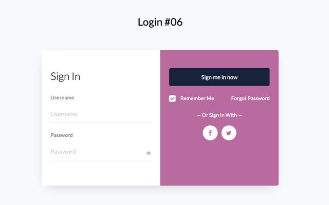</a> <b>Login Form 16</b> <a href="https://preview.colorlib.com/#login-form-16">Demo</a> · <a href="login-form-16/">Code</a> · <a href="https://colorlib.com/wp/template/login-form-16/">Details</a></td>
<td align="center" width="33%"><a href="https://preview.colorlib.com/#login-form-17">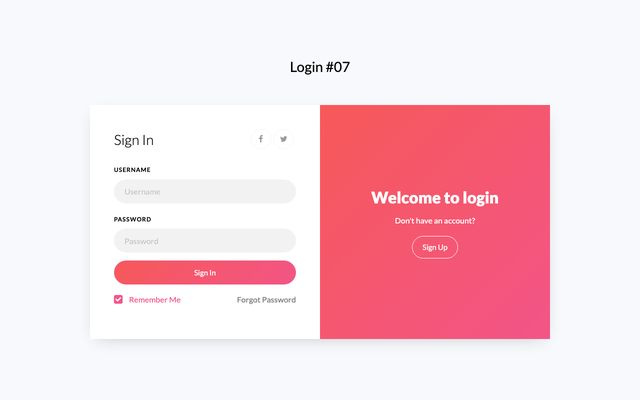</a> <b>Login Form 17</b> <a href="https://preview.colorlib.com/#login-form-17">Demo</a> · <a href="login-form-17/">Code</a> · <a href="https://colorlib.com/wp/template/login-form-17/">Details</a></td>
<td align="center" width="33%"><a href="https://preview.colorlib.com/#login-form-18">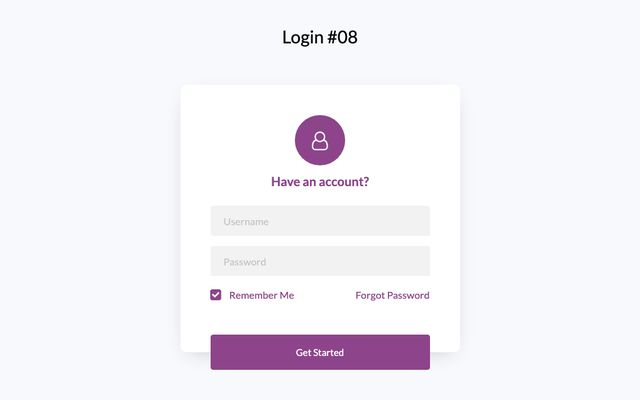</a> <b>Login Form 18</b> <a href="https://preview.colorlib.com/#login-form-18">Demo</a> · <a href="login-form-18/">Code</a> · <a href="https://colorlib.com/wp/template/login-form-18/">Details</a></td>
</tr>
<tr>
<td align="center" width="33%"><a href="https://preview.colorlib.com/#login-form-19">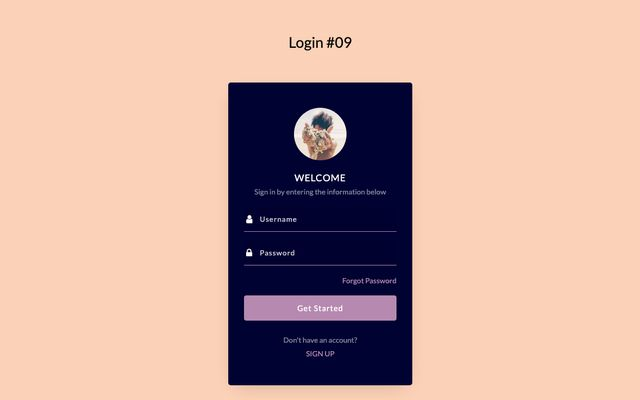</a> <b>Login Form 19</b> <a href="https://preview.colorlib.com/#login-form-19">Demo</a> · <a href="login-form-19/">Code</a> · <a href="https://colorlib.com/wp/template/login-form-19/">Details</a></td>
<td align="center" width="33%"><a href="https://preview.colorlib.com/#login-form-20">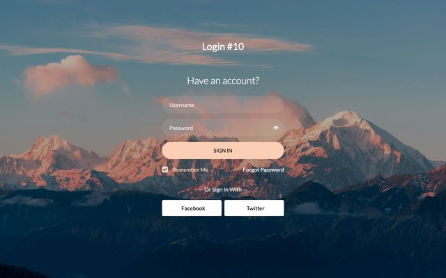</a> <b>Login Form 20</b> <a href="https://preview.colorlib.com/#login-form-20">Demo</a> · <a href="login-form-20/">Code</a> · <a href="https://colorlib.com/wp/template/login-form-20/">Details</a></td>
</tr>
</table>

## Full login pages

<table>
<tr>
<td align="center" width="33%"><a href="https://preview.colorlib.com/#login-page-01">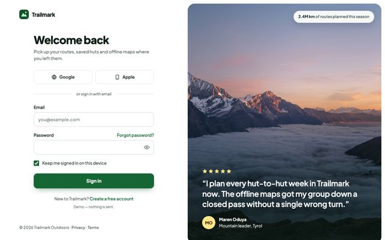</a> <b>Login Page 01</b> <a href="https://preview.colorlib.com/#login-page-01">Demo</a> · <a href="login-page-01/">Code</a> · <a href="https://colorlib.com/wp/template/login-page-01/">Details</a></td>
<td align="center" width="33%"><a href="https://preview.colorlib.com/#login-page-02">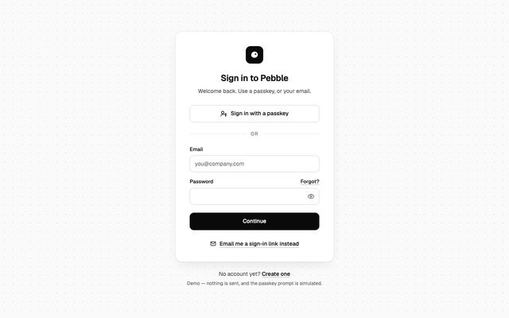</a> <b>Login Page 02</b> <a href="https://preview.colorlib.com/#login-page-02">Demo</a> · <a href="login-page-02/">Code</a> · <a href="https://colorlib.com/wp/template/login-page-02/">Details</a></td>
<td align="center" width="33%"><a href="https://preview.colorlib.com/#login-page-03">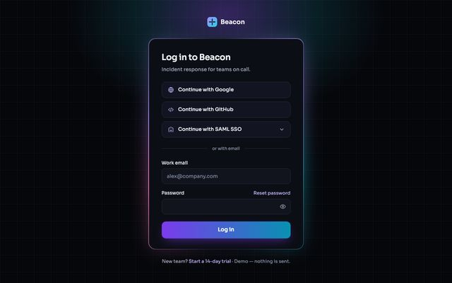</a> <b>Login Page 03</b> <a href="https://preview.colorlib.com/#login-page-03">Demo</a> · <a href="login-page-03/">Code</a> · <a href="https://colorlib.com/wp/template/login-page-03/">Details</a></td>
</tr>
<tr>
<td align="center" width="33%"><a href="https://preview.colorlib.com/#login-page-04">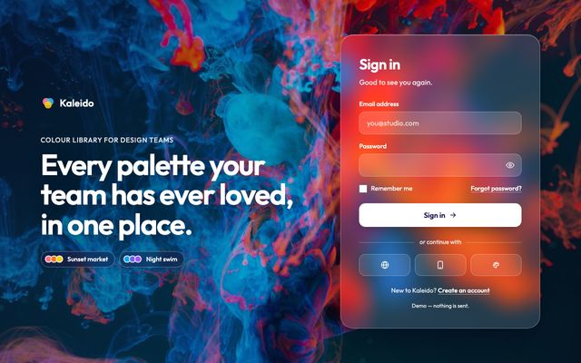</a> <b>Login Page 04</b> <a href="https://preview.colorlib.com/#login-page-04">Demo</a> · <a href="login-page-04/">Code</a> · <a href="https://colorlib.com/wp/template/login-page-04/">Details</a></td>
<td align="center" width="33%"><a href="https://preview.colorlib.com/#login-page-05">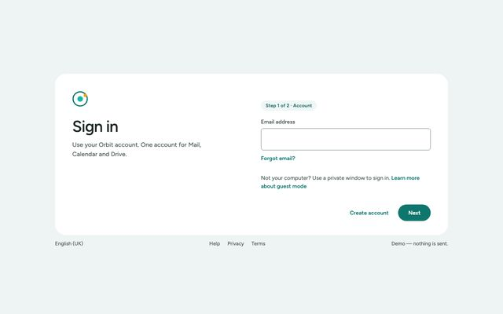</a> <b>Login Page 05</b> <a href="https://preview.colorlib.com/#login-page-05">Demo</a> · <a href="login-page-05/">Code</a> · <a href="https://colorlib.com/wp/template/login-page-05/">Details</a></td>
<td align="center" width="33%"><a href="https://preview.colorlib.com/#login-page-06">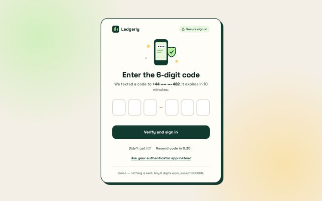</a> <b>Login Page 06</b> <a href="https://preview.colorlib.com/#login-page-06">Demo</a> · <a href="login-page-06/">Code</a> · <a href="https://colorlib.com/wp/template/login-page-06/">Details</a></td>
</tr>
<tr>
<td align="center" width="33%"><a href="https://preview.colorlib.com/#login-page-07">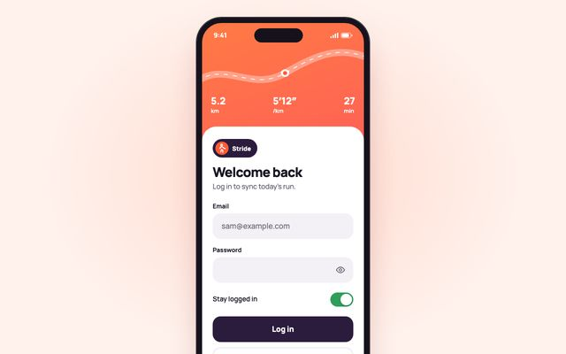</a> <b>Login Page 07</b> <a href="https://preview.colorlib.com/#login-page-07">Demo</a> · <a href="login-page-07/">Code</a> · <a href="https://colorlib.com/wp/template/login-page-07/">Details</a></td>
<td align="center" width="33%"><a href="https://preview.colorlib.com/#login-page-08">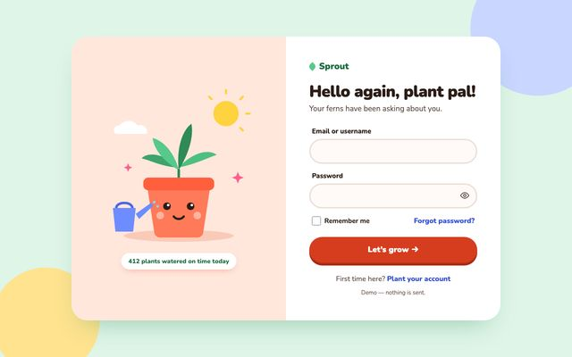</a> <b>Login Page 08</b> <a href="https://preview.colorlib.com/#login-page-08">Demo</a> · <a href="login-page-08/">Code</a> · <a href="https://colorlib.com/wp/template/login-page-08/">Details</a></td>
<td align="center" width="33%"><a href="https://preview.colorlib.com/#login-page-09">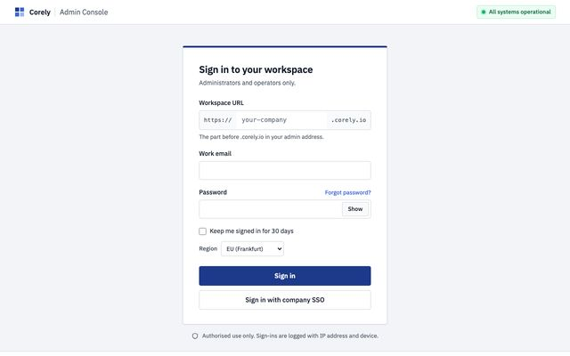</a> <b>Login Page 09</b> <a href="https://preview.colorlib.com/#login-page-09">Demo</a> · <a href="login-page-09/">Code</a> · <a href="https://colorlib.com/wp/template/login-page-09/">Details</a></td>
</tr>
<tr>
<td align="center" width="33%"><a href="https://preview.colorlib.com/#login-page-10">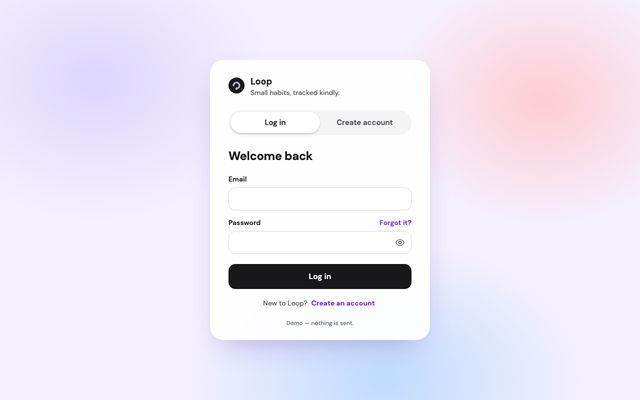</a> <b>Login Page 10</b> <a href="https://preview.colorlib.com/#login-page-10">Demo</a> · <a href="login-page-10/">Code</a> · <a href="https://colorlib.com/wp/template/login-page-10/">Details</a></td>
</tr>
</table>

## How to use one

1. Clone the repo, or download it as a ZIP from the green **Code** button.
2. Copy the folder of the template you want into your project.
3. Open its `index.html` in a browser. Every folder is self-contained: `css/style.css`, a small `js/snippet.js` where the template needs behaviour, plus its own fonts and images.

Using Bootstrap already? Load the template's `css/style.css` after your framework stylesheet. Class names are namespaced per template, so they won't collide with yours.

## License

Free for personal and commercial use, including client work. Attribution is appreciated but not required. Photography, where present, is licensed for use inside these templates. See [LICENSE.md](LICENSE.md).

## More free templates from Colorlib

- [Free HTML & CSS Registration Form Templates](https://github.com/ColorlibHQ/registration-form-templates)
- [Free Coming Soon & Under Construction Page Templates](https://github.com/ColorlibHQ/coming-soon-page-templates)
- [Free HTML & CSS Contact Form Templates](https://github.com/ColorlibHQ/contact-form-templates)
- [Free 404 & Error Page Templates](https://github.com/ColorlibHQ/404-error-page-templates)
- [Free Multi-Step Form & Form Wizard Templates](https://github.com/ColorlibHQ/multi-step-form-templates)
- [Free Booking & Appointment Form Templates](https://github.com/ColorlibHQ/booking-form-templates)
- [Free HTML & CSS Search Form Templates](https://github.com/ColorlibHQ/search-form-templates)
- [Free Navigation Menu, Sidebar & Dropdown Templates](https://github.com/ColorlibHQ/navigation-menu-templates)
- [Free HTML & CSS Table Templates](https://github.com/ColorlibHQ/html-table-templates)
- [Free HTML Form Templates: Job Application, Survey & Newsletter](https://github.com/ColorlibHQ/html-form-templates)
- [Free HTML & CSS UI Components](https://github.com/ColorlibHQ/html-css-ui-components)

Building an admin panel or a web app?

- [Gentelella](https://github.com/ColorlibHQ/gentelella) and [Adminator](https://github.com/puikinsh/Adminator-admin-dashboard): free admin dashboard templates
- [DashboardPack](https://dashboardpack.com/templates/?utm_source=github&utm_medium=readme&utm_campaign=login-form-templates): premium dashboards for React, Vue, Angular, Next.js, Laravel and plain HTML

Made by [Colorlib](https://colorlib.com/).
